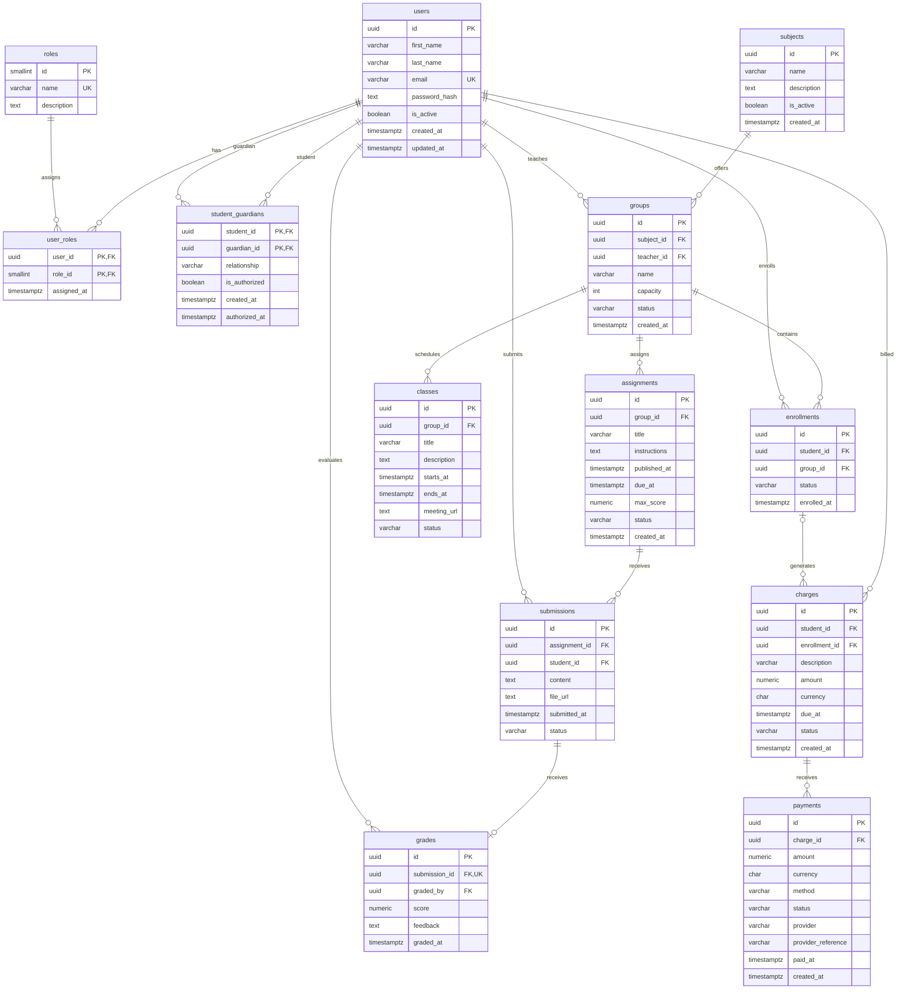

# Academia Platform — Diagrama entidad-relación

## Versión conceptual 1.0

## Notas

- PK: clave primaria.
- FK: clave foránea.
- UK: restricción de unicidad.
- Las relaciones representan el diseño lógico inicial.
- Las restricciones avanzadas se implementarán
  mediante migraciones y lógica de negocio.
- Los permisos y autorizaciones se validarán
  desde el backend.
